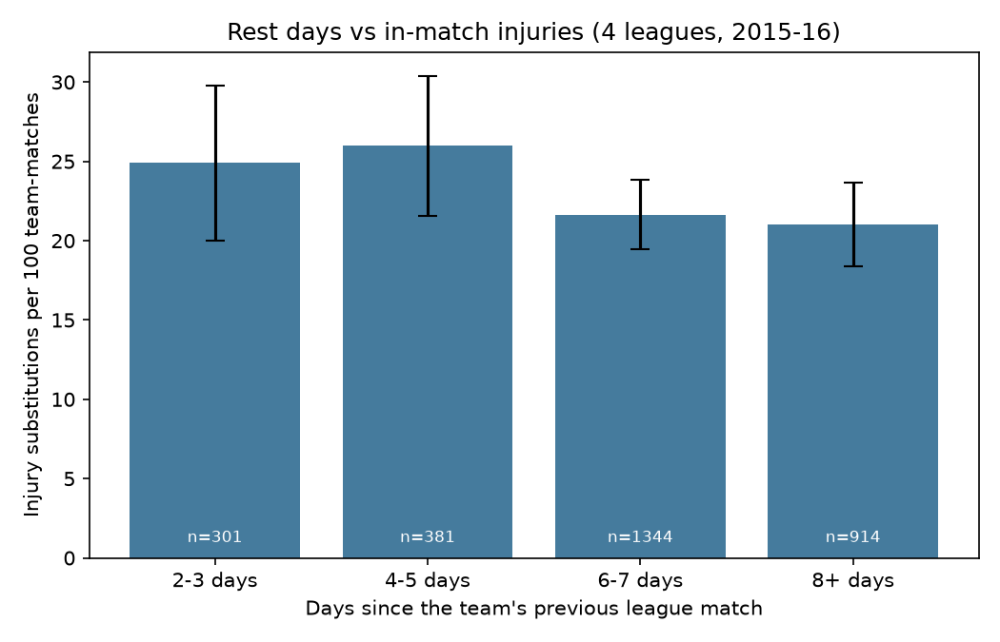
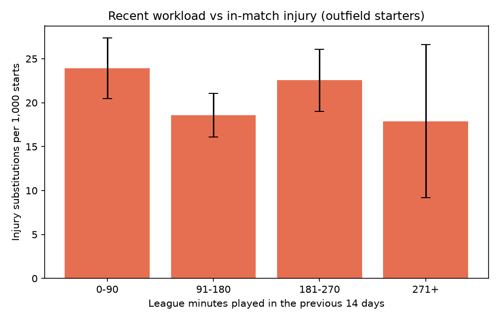
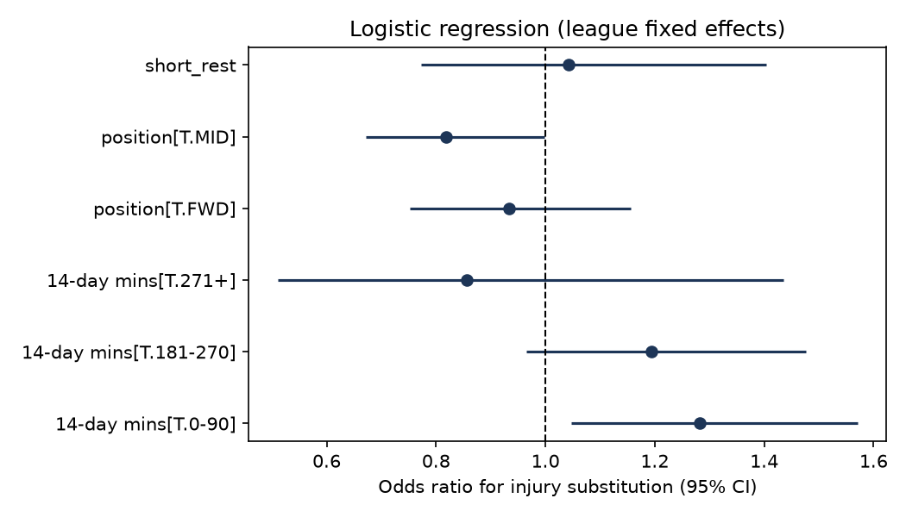
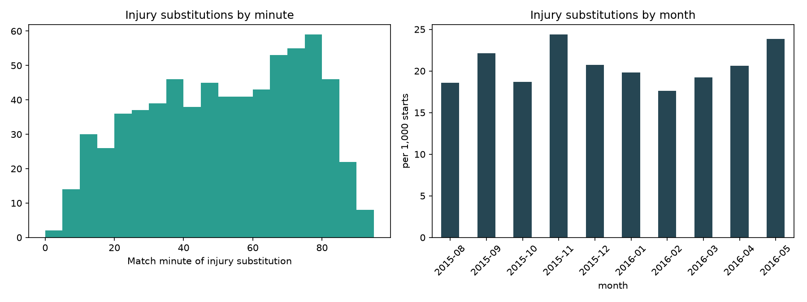
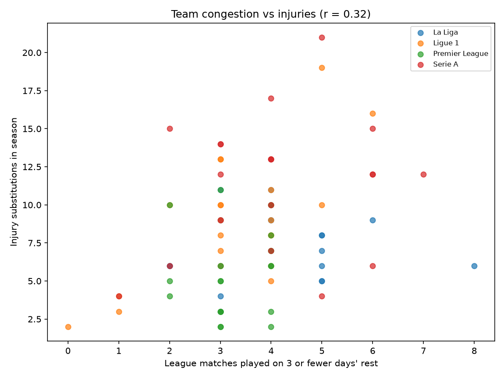

# Fixture congestion, workload and injury risk

Do short turnarounds and heavy recent minutes lead to more injuries? This project builds workload histories for every player
in four top leagues (2015-16) from StatsBomb event data. It uses **in-match injury substitutions** as the injury outcome, and it is upfront
about what public data can and can't show.

Author: Anthony Adusei-Poku ([@anthony07-max](https://github.com/anthony07-max))



## Key findings (1,517 matches, 42,096 player appearances, 681 injury substitutions)
1. **The injury label holds up.** Starters taken off for injury missed their team's next league match **65%** of the time,
   against 17% for other starters. So StatsBomb's "Injury" substitution tag is a reasonable stand-in for a real injury.
2. **Short rest shows a small, uncertain rise.** Teams on 4-5 days' rest had 26.0 injury substitutions per 100 matches, and on 2-3 days 24.9,
   against 21.7 on 6-7 days. In a Poisson model with league effects, the rate ratios are 1.21 (95% CI 0.96 to 1.52) and 1.14 (0.89 to 1.47).
   The direction matches the research literature, **but it isn't statistically significant** with one season of data.
3. **The clearest signal is coming back, not overload.** Starters with **0-90 league minutes in the previous 14 days** had **28% higher odds**
   of an injury substitution (OR 1.28, CI 1.05 to 1.57, p = 0.016) than regulars on 91-180 minutes. This fits the well-known risk for players
   returning from injury or a spell out of the side. The heaviest-load group (271+ minutes) shows no extra risk, but it's small (n = 894 starts).
4. **League matters more than schedule.** Serie A (OR 1.52) and Ligue 1 (1.41) had far more injury substitutions than La Liga, and the Premier League had fewer (0.79).
   That could be differences in physical demands, medical culture or substitution habits. Only 39% of injury substitutions happen in the first half.
5. **Team level:** teams with more short turnarounds had more injury substitutions (r = 0.32). This is confounded, though, because those are mostly bigger clubs
   with stronger squads and European fixtures.

| | |
|---|---|
|  |  |
|  |  |

## Data limits (please read)
- **No public injury database is used.** Club medical data is private, and sites like Transfermarkt don't allow scraping. The outcome is an **in-match
  injury substitution**. That misses injuries picked up in training, injuries to unused players, and injuries where the player finished the match.
- **Only league matches are counted.** The free data has no cup or European fixtures, so congestion and minutes are **underestimated** for clubs in Europe.
- **There's no physical tracking data** (distance or sprints). "Intensity" is approximated by counts of pressures, duels and dribbles.
- This is observational and covers one season. These are associations, not causal effects, and the confidence intervals are wide. A club with GPS and medical records could run
  the same pipeline (`src/clean.py` builds 7, 14 and 28-day rolling loads) with far better outcomes.

## Method
- `src/clean.py` rebuilds every appearance (start and end minute, started or not, injury substitution) from line-ups and substitutions. It then computes
  each player's league minutes in the previous 7, 14 and 28 days (strictly before kick-off), days since his last appearance, team rest days, and whether he
  played the next match.
- `src/analysis.py` covers the validation check, a team-level Poisson GLM (injury substitutions ~ rest band + league), and a player-level logistic regression
  (outfield starters with at least 3 earlier appearances: injury ~ 14-day minutes band + rest of 3 days or fewer + position + league), plus descriptive charts.

## Data source
- [StatsBomb Open Data](https://github.com/statsbomb/open-data): 2015-16 Premier League, La Liga, Serie A and Ligue 1 (events, line-ups, substitutions with
  the tactical or injury reason). Used under the [StatsBomb public data user agreement](https://github.com/statsbomb/open-data/blob/master/LICENSE.pdf). Data provided by **StatsBomb (Hudl)**.

## How to run
```bash
python -m venv .venv && source .venv/bin/activate
pip install -r requirements.txt
bash run_pipeline.sh      # downloads StatsBomb events (several GB of JSON, reduced to parquet), then about 15 s of analysis
```
